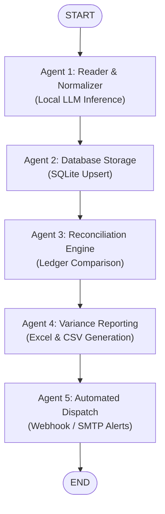

# Pipeline Architecture & Technical Design

This document details the internal architecture, state transitions, domain entities, and agent interaction model for the local financial transaction ingestion pipeline.

---

## 1. High-Level Topology

The pipeline is implemented as a directed acyclic state graph (`StateGraph`) using **LangGraph**. State flows linearly across 5 specialized agent nodes:



---

## 2. Shared State Model (`AgentState`)

All agent nodes communicate through a shared, immutable-friendly TypedDict state:

```python
class AgentState(TypedDict):
    raw_file_path: str
    transactions: List[dict]
    reconciliation_results: List[dict]
    db_status: str                     # PENDING, COMMITTED, SKIPPED
    report_path: Optional[str]         # Path to generated .xlsx report
    dispatch_status: str               # PENDING, SENT_SMTP, SENT_WEBHOOK, SKIPPED_THRESHOLD, FAILED
    messages: Annotated[List[BaseMessage], add_messages]
```

### State Accumulation (`add_messages`)
Agent execution messages and audit logs are appended sequentially to `messages` using LangGraph's `add_messages` reducer. This maintains a complete audit trail of decisions made at each stage.

---

## 3. The 5 Agent Files & Classes

Each agent is defined in its own dedicated, self-contained file with an object-oriented agent class and a LangGraph node function:

| Agent | Dedicated File | Agent Class | Node Function |
|---|---|---|---|
| **Agent 1: Reader & Normalizer** | [`agents/reader_agent.py`](../agents/reader_agent.py) | `ReaderAgent` | `reader_agent_node` |
| **Agent 2: Database Storage** | [`agents/storage_agent.py`](../agents/storage_agent.py) | `StorageAgent` | `storage_agent_node` |
| **Agent 3: Reconciliation Engine** | [`agents/reconciliation_agent.py`](../agents/reconciliation_agent.py) | `ReconciliationAgent` | `reconciliation_agent_node` |
| **Agent 4: Variance Reporting** | [`agents/reporting_agent.py`](../agents/reporting_agent.py) | `ReportingAgent` | `reporting_agent_node` |
| **Agent 5: Automated Dispatch** | [`agents/dispatch_agent.py`](../agents/dispatch_agent.py) | `DispatchAgent` | `dispatch_agent_node` |

The orchestration harness is defined in its own file:
- **Harness**: [`harness.py`](../harness.py) (and [`src/pipeline/harness.py`](../src/pipeline/harness.py)) providing `FinancialPipelineHarness`, `build_financial_pipeline()`, and `build_core_financial_pipeline()`.

---

### Detailed Agent Responsibilities

#### Agent 1: Reader & Normalizer Agent ([`agents/reader_agent.py`](../agents/reader_agent.py))
- **Responsibilities**:
  1. Inspects file extension (`.csv` or `.pdf`).
  2. Uses `read_raw_csv_content` with CSV sniffing (semicolon vs. comma autodetection) or `extract_pdf_bank_statement` to stream raw text.
  3. Verifies LM Studio health (`/v1/models`).
  4. Invokes the local LLM (`qwen3.8-27b-uncensored-mlx`) with strict Pydantic JSON schema instructions.
  5. Strips markdown fences and reasoning blocks (`<think>...</think>`), validating against `TransactionBatch`.

#### Agent 2: Database Storage Agent ([`agents/storage_agent.py`](../agents/storage_agent.py))
- **Responsibilities**:
  1. Receives normalized transactions from state.
  2. Executes idempotent batch upserts (`INSERT OR REPLACE INTO transactions`).
  3. Updates `db_status` to `COMMITTED` (or `SKIPPED` if 0 records).

#### Agent 3: Reconciliation Engine Agent ([`agents/reconciliation_agent.py`](../agents/reconciliation_agent.py))
- **Responsibilities**:
  1. Reads `expected_invoices` from the database.
  2. Matches descriptions using normalized keyword fuzzy search.
  3. Computes the numeric variance (`actual_amount - expected_amount`).
  4. Tags each item:
     - `EXACT_MATCH`: Variance is zero ($< 0.01$).
     - `AMOUNT_MISMATCH`: Keywords matched, but amount differs.
     - `UNMATCHED`: No corresponding invoice found in expected ledger.

#### Agent 4: Variance Reporting Agent ([`agents/reporting_agent.py`](../agents/reporting_agent.py))
- **Responsibilities**:
  1. Filters for exception records (`AMOUNT_MISMATCH` and `UNMATCHED`).
  2. If discrepancies exist, builds a tabular dataset.
  3. Writes UTF-8 CSV with semicolon separators (`reports/variance_summary_<timestamp>.csv`).
  4. Writes a styled Excel spreadsheet (`reports/variance_summary_<timestamp>.xlsx`) with dynamic column auto-sizing via `openpyxl`.

#### Agent 5: Automated Dispatch Agent ([`agents/dispatch_agent.py`](../agents/dispatch_agent.py))
- **Responsibilities**:
  1. Evaluates discrepancy count against `DISPATCH_COUNT_THRESHOLD` (default: 1).
  2. Evaluates absolute cumulative variance against `DISPATCH_VARIANCE_THRESHOLD` (default: 50.00 CHF).
  3. If breached:
     - **Webhook mode**: Posts structured JSON payload to endpoint (Slack/Teams compatible).
     - **SMTP mode**: Constructs email with the `.xlsx` file attached and sends via TLS.

---

## 4. Database Schema (SQLite)

The local ledger maintains two tables:

```sql
-- Actual ingested bank transactions
CREATE TABLE IF NOT EXISTS transactions (
    transaction_id TEXT PRIMARY KEY,
    date TEXT NOT NULL,
    description TEXT NOT NULL,
    amount REAL NOT NULL,
    currency TEXT NOT NULL,
    ingested_at TIMESTAMP DEFAULT CURRENT_TIMESTAMP
);

-- Expected invoices and commitments
CREATE TABLE IF NOT EXISTS expected_invoices (
    expected_id TEXT PRIMARY KEY,
    party_name TEXT NOT NULL,
    expected_amount REAL NOT NULL,
    due_date TEXT NOT NULL,
    currency TEXT NOT NULL
);
```

Default seed data includes recurring obligations (e.g. apartment rent, telecom, energy).

---

## 5. Resilient Local LLM Integration

Local reasoning models (such as Qwen 2.5 / 3.x 27B) run on Apple Silicon Metal via LM Studio:
- **Health Check Pre-Flight**: Pings `/v1/models` with 3.0s timeout before dispatching prompts to avoid hung threads.
- **Failover Route**: Attempts `http://localhost:1234/v1`, falling back to LAN IP if configured.
- **Reasoning Token Tolerance**: Extended timeout (`LM_STUDIO_TIMEOUT=180.0s`) accommodates chain-of-thought generation before JSON output.
- **JSON Sanitization**: Robustly strips markdown fences and `<think>...</think>` tags to guarantee strict Pydantic validation.

