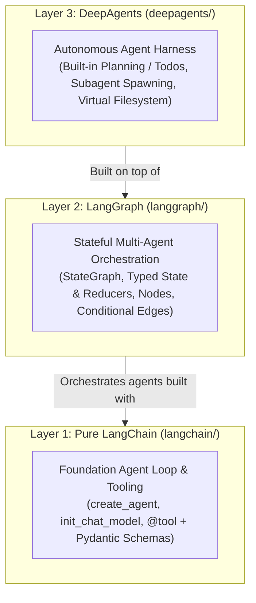

# LangChain Ecosystem Documentation Hub (`docs/`)

Welcome to the centralized **`docs/`** directory for **`langchain-ecosystem`**. This folder mirrors the exact repository structure of the subprojects so every concept, architectural pattern, and design decision learned along the way is documented in one organized hierarchy.

---

## Documentation Tree (`docs/`)

```text
docs/
├── README.md                                  # Documentation Hub & 3-Layer Ecosystem Guide (this file)
├── langchain-ecosystem-architecture.html      # Interactive Archify Diagram — Global Ecosystem
├── langchain/                                 # Layer 1: Pure LangChain v1.x Agents & Tools
│   ├── lca-single-agent/
│   │   ├── README.md                          # Stage 1 Learning Guide: Single Agent (BTA)
│   │   ├── architecture.md                    # Stage 1 Architecture: Schemas, Deduplication & Watcher
│   │   └── lca-single-agent-architecture.html # Interactive Archify Diagram — Stage 1
│   └── lca-two-agents/
│       ├── README.md                          # Stage 2 Learning Guide: Two Agents (BTA + AA)
│       ├── architecture.md                    # Stage 2 Architecture: Editable Reuse & Tool Handoff
│       └── lca-two-agents-architecture.html   # Interactive Archify Diagram — Stage 2
├── langgraph/                                 # Layer 2: Stateful Multi-Agent Graph Orchestration
│   └── lca-langgraph-agents/
│       ├── README.md                          # Stage 3 Learning Guide: 4 Pillars of LangGraph StateGraph
│       ├── architecture.md                    # Stage 3 Architecture: State, Nodes, Conditional Edges
│       └── lca-langgraph-agents-architecture.html # Interactive Archify Diagram — Stage 3
└── deepagents/                                # Layer 3: Autonomous Agent Harness on top of LangGraph
    ├── deep-agents-example/
    │   ├── README.md                          # DeepAgents Bank Reconciliation Overview
    │   ├── architecture.md                    # DeepAgents Harness & Subagent Architecture
    │   ├── deep-agents-example-architecture.html # Interactive Archify Diagram — Layer 3
    │   ├── configuration.md                   # Configuration Guide
    │   ├── getting_started.md                 # Getting Started Guide
    │   └── usage_guide.md                     # Usage Guide
    └── lca-deepagents/
        └── README.md                          # LangChain Academy DeepAgents Course Notes
```

---

## The Three Layers of the LangChain Ecosystem



| Layer | Framework | Documentation Link | Interactive Archify Diagram (GitHub Pages) | Core Responsibility |
| :--- | :--- | :--- | :--- | :--- |
| **Global** | All 3 Layers | [`README.md`](../README.md) | [**Open Global Ecosystem Diagram**](https://marcusmaccio.github.io/langchain-ecosystem/langchain-ecosystem-architecture.html) | End-to-end overview of LangChain, LangGraph, and DeepAgents with local LM Studio inference. |
| **Layer 1 (Stage 1)** | `langchain` (Single Agent) | [`docs/langchain/lca-single-agent/`](langchain/lca-single-agent/README.md) | [**Open Stage 1 Diagram**](https://marcusmaccio.github.io/langchain-ecosystem/langchain/lca-single-agent/lca-single-agent-architecture.html) | Give a single LLM structured `@tool` capabilities (`create_agent`) while delegating deterministic math, deduplication, and caching to Python tools. |
| **Layer 1 (Stage 2)** | `langchain` (Two Agents) | [`docs/langchain/lca-two-agents/`](langchain/lca-two-agents/README.md) | [**Open Stage 2 Diagram**](https://marcusmaccio.github.io/langchain-ecosystem/langchain/lca-two-agents/lca-two-agents-architecture.html) | Reuse Agent 1 (`BTA`) via editable packaging (`editable = true`) and connect Agent 2 (`AA`) via an optional tool-based handoff (`notify_accounting_agent`) while preserving standalone execution (`--bta-only`, `--aa-only`). |
| **Layer 2 (Stage 3)** | `langgraph` (`StateGraph`) | [`docs/langgraph/lca-langgraph-agents/`](langgraph/lca-langgraph-agents/README.md) | [**Open Stage 3 Diagram**](https://marcusmaccio.github.io/langchain-ecosystem/langgraph/lca-langgraph-agents/lca-langgraph-agents-architecture.html) | Separate *agent logic* from *workflow routing* using a declarative `StateGraph` (`discover_files -> bta_node -> aa_node`) with typed state, reducers, and conditional short-circuiting. |
| **Layer 3** | `deepagents` | [`docs/deepagents/deep-agents-example/`](deepagents/deep-agents-example/README.md) | [**Open Layer 3 Diagram**](https://marcusmaccio.github.io/langchain-ecosystem/deepagents/deep-agents-example/deep-agents-example-architecture.html) | High-level autonomous harness built on LangGraph with built-in task planning, subagent delegation, and virtual filesystem tools. |
