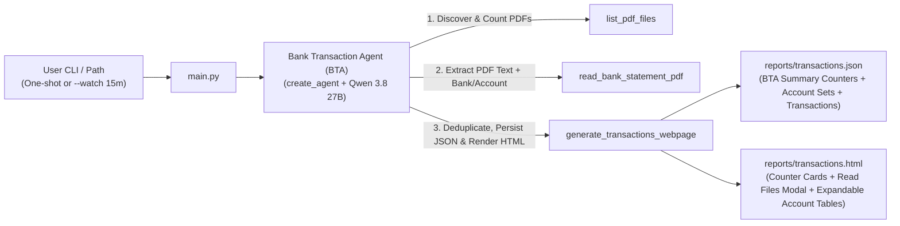

# Stage 1 Architecture — Bank Transaction Agent (`lca-single-agent`)

## Data Flow & Component Architecture



---

## Key Architectural Features

### 1. Composite Deduplication Key (`_deduplicate_transactions`)
Bank statements can contain multiple legitimate payments on the same day for the same amount (e.g., two rent transfers on `2026-02-24` for `1,150.00 CHF` with different references: `Bail fevrier 2026` vs. `Bail mars 2026`).
To avoid false-positive deduplication while still removing true duplicates across overlapping PDF statements, BTA uses the composite key:
```python
key = (
    tx.date.strip(),
    round(float(tx.amount), 2),
    tx.currency.strip().upper(),
    " ".join(tx.description.strip().lower().split()),
    " ".join(tx.reference.strip().lower().split()),
)
```

### 2. Per-Bank and Per-Account Grouping (`AccountTransactionSet`)
Every extracted `TransactionItem` records `bank_name` and `bank_account`. When `generate_transactions_webpage` runs, it groups transactions by `(bank_name, bank_account)` into `AccountTransactionSet` objects, computing per-account credits, debits, net cashflow, and date ranges.

### 3. Expandable HTML Sections (`<details class="account-section">`)
In `reports/transactions.html`, each Bank & Bank Account renders as an expandable `<details>` card:
- **Always visible (`<summary class="account-banner">`)**: Bank name badge, Bank Account / IBAN title, period range, and summary badges (`Transactions`, `Credits`, `Debits`, `Net Cash Flow`).
- **Expanded on click**: Searchable transaction table with `#`, `Date`, `Bank & Account`, `Description`, `Reference`, `Amount`, and `Source PDF` (with clickable `file://` links).

### 4. Incremental 15-Minute Folder Watcher (`--watch`)
- `find_new_pdf_files(folder_path, json_cache_path)` compares the filenames in the target folder against `summary.read_files` in `reports/transactions.json`.
- When new PDFs appear, `load_existing_bta_state` preloads previously extracted transactions into memory so the LLM only parses the **new** PDF file(s) and merges them with existing transactions.
