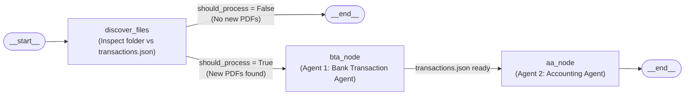

# Stage 3 Architecture — LangGraph StateGraph Workflow (`lca-langgraph-agents`)

## Compiled LangGraph Topology



---

## State Schema (`WorkflowState`)

Defined in [`src/workflow.py`](../../../langgraph/lca-langgraph-agents/src/workflow.py):

```python
class WorkflowState(TypedDict, total=False):
    pdf_path: str
    bta_html_path: str
    bta_json_path: str
    balance_html_path: str
    balance_json_path: str
    incremental: bool
    open_browser: bool
    new_files: list[str]
    existing_files_count: int
    should_process: bool
    bta_response: str
    aa_response: str
    workflow_steps: Annotated[list[str], operator.add]
```

---

## Execution Modes

1. **Full Scan Mode (`incremental=False`)**:
   - `discover_files` lists all `.pdf` files in `pdf_path` and sets `should_process = True`.
   - `bta_node` runs BTA across all discovered PDFs and outputs `reports/transactions.json` + `reports/transactions.html`.
   - `aa_node` runs AA on `reports/transactions.json` and outputs `reports/balance.json` + `reports/balance.html`.
2. **Incremental 15-Minute Watch Mode (`incremental=True`, `--watch`)**:
   - Every 15 minutes, `discover_files` calls `find_new_pdf_files(pdf_path, bta_json_path)`.
   - **No new files**: `should_process = False` $\rightarrow$ `route_after_discovery` transitions immediately to `END` (`__end__`).
   - **New files found**: `should_process = True` $\rightarrow$ `bta_node` preloads existing state via `load_existing_bta_state`, extracts only the new PDF(s), updates `reports/transactions.json`, and transitions to `aa_node` to recalculate the Balance.
